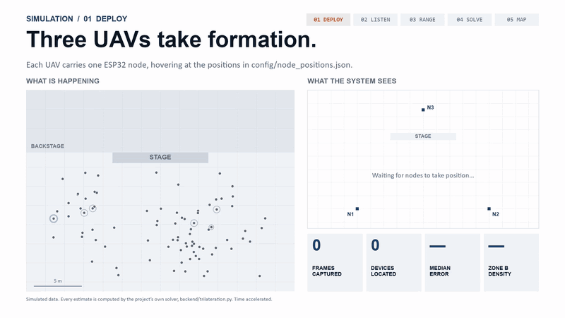
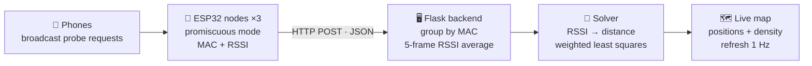
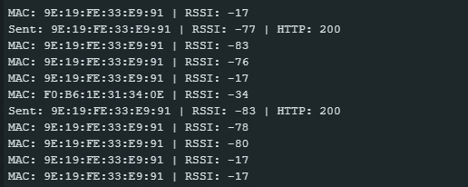
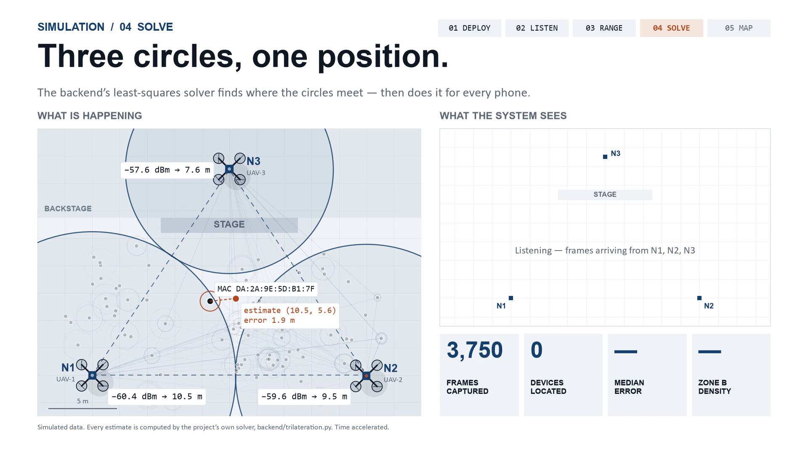
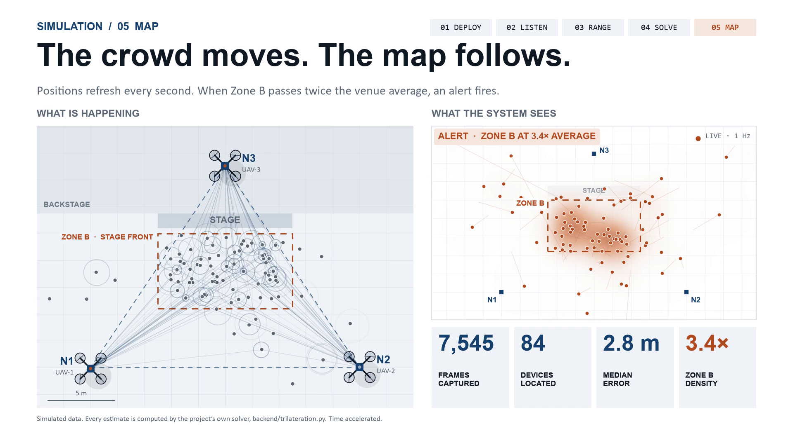
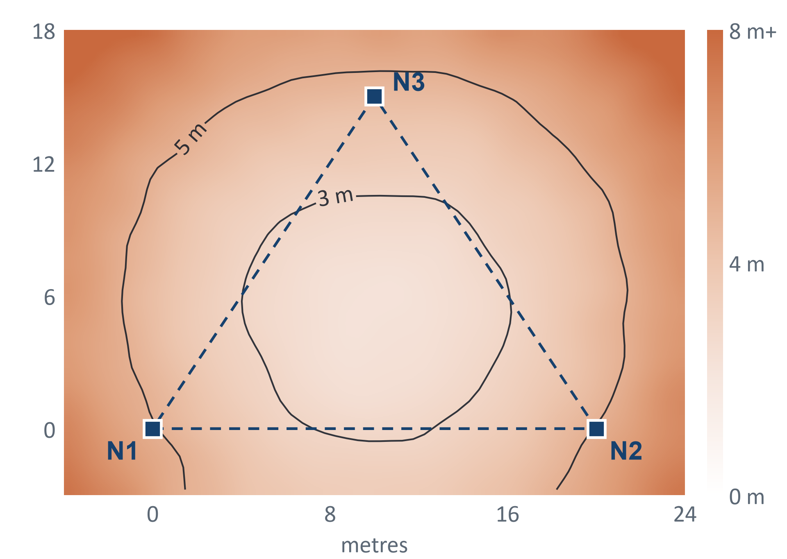

<div align="center">

# Drone-Based Crowd Monitoring

### Locating people from the WiFi their phones already broadcast — no cameras.




<sub>Every position on the right is computed by this repo's own <code>backend/trilateration.py</code> from simulated signal strengths. &nbsp;·&nbsp; <a href="simulation/simulation.mp4">Full 1080p video</a></sub>

</div>

---

## Highlights

- **End-to-end system, hardware to dashboard.** Custom ESP32 firmware sniffs raw 802.11 frames, a Flask backend fuses readings from three radios, and a live map renders positions and crowd density at 1 Hz.
- **Found and fixed a silent firmware bug.** The packet-header struct was missing the `addr1` field, so the sniffer had been logging the *receiver's* MAC (mostly broadcast) instead of the phone's. Fixing it to read `addr2` at byte offset 10, verified with `offsetof` against the 802.11 wire format, recovered the traffic the system exists to measure.
- **Simulated a deployment the hardware couldn't fly yet.** A three-UAV simulation runs the production solver on a virtual crowd of 84 phones: drones take formation, devices are ranged and trilaterated, and a density alert fires when the crowd surges.
- **Quantified accuracy instead of guessing it.** A 282,240-solve Monte Carlo study maps error across the whole area. It shows ~2.8 m inside the node triangle, and shows that one miscalibrated constant inflates error to ~35 m.
- **Privacy by construction.** No camera and no image ever. The system only reads what phones already broadcast in the clear, and it reports density, not identity.

## The idea

Crowd density is a safety number. The usual way to measure it is cameras, which record everyone's face. But an operator only needs **how many people, and roughly where**.

Every WiFi-enabled phone constantly broadcasts unencrypted **probe requests**, even when it isn't connected to anything. Three ESP32 radios, carried by drones, listen to those packets and measure their signal strength. A server turns signal strength into distance, and three distances into a position. Then it draws a live density map.

| | Camera | This project |
|---|---|---|
| Counts | precisely | approximately |
| Records | every face | no image at all |
| Works in darkness & smoke | ✗ | ✓ |
| Cost of a 3-node setup | high | ~₹2,000 |

## How it works



1. **Capture.** Each ESP32 runs in promiscuous mode and reads the source MAC and RSSI of every 802.11 management frame it hears. It filters out broadcast and multicast addresses and anything weaker than −85 dBm.
2. **Ranging.** The log-distance path-loss model turns signal strength into metres:
   `d = 10^((RSSI₀ − RSSI) / (10·n))`, with RSSI₀ = −40 dBm and n = 2.0 by default.
3. **Solving.** Subtracting one circle equation from the others linearises the problem to `Ax = b`. The backend solves it with **weighted least squares**, weighting each row by `1/d²` so that closer, more reliable nodes count for more.
4. **Mapping.** The browser polls the backend once a second and draws device positions, trails and density on a floor-plan canvas.

## Hardware

<table>
<tr>
<td width="55%">

- **3 × ESP32-WROOM** (one per UAV), ~₹400 each
- Firmware: Arduino core, `esp_wifi` promiscuous callback
- Each node POSTs `{device_id, mac, rssi, timestamp}` to the backend once a second
- Capture pauses briefly during each upload, because one radio can't listen and transmit at the same time
- Node positions are surveyed once into [`config/node_positions.json`](config/node_positions.json)

</td>
<td>



<sub>Real ESP32 output: live MACs and RSSI, with <code>HTTP 200</code> when a reading reaches the backend. &nbsp;<a href="Working.mp4">Full recording</a></sub>

</td>
</tr>
</table>

## Simulation

We couldn't fly three drones for the demo, so we simulated the full deployment, running **the project's real solver**. Synthetic RSSI with 4 dB of log-normal noise goes through the same pipeline as live data: a 5-frame average, then `rssi_to_distance`, then `trilaterate_ls`.

| | Phase | What you see |
|---|---|---|
| 01 | **Deploy** | Three UAVs take up a surveyed triangle |
| 02 | **Listen** | Phones broadcast; each node logs MAC + RSSI |
| 03 | **Range** | For one phone, three readings become three distance circles |
| 04 | **Solve** | Least squares finds where the circles meet, then does it for every phone |
| 05 | **Map** | The crowd surges toward the stage; the density map flags Zone B at over 2× the venue average |

<p align="center">


</p>

## Results



**282,240** simulated solves of the backend solver across the whole area:

| | Median error |
|---|---|
| Inside the node triangle | **2.8 m** |
| Outside it | **4.8 m** |
| If the real path-loss exponent is 2.7 but the backend assumes 2.0 | **~35 m** |

Two lessons:

- **Geometry matters.** Fly the triangle *over* the area you want to monitor.
- **Calibration is not optional.** One constant, `n`, decides whether the system works, so it has to be measured on site.

<br clear="right"/>

## Quick start

**Backend**
```bash
pip install -r backend/requirements.txt
python backend/app.py          # dashboard at http://localhost:5000
```

**Firmware.** Open `esp_nodes/espN/espN.ino` in the Arduino IDE and install **ArduinoJson 6.x** from the Library Manager. Then copy `secrets.example.h` to `secrets.h` in the same folder and fill in your WiFi details and the laptop's IP:
```cpp
#define WIFI_SSID     "your-wifi"
#define WIFI_PASSWORD "your-password"
#define SERVER_URL    "http://<laptop-ip>:5000/endpoint"
```
`secrets.h` is gitignored. Give each board its own `DEVICE_ID` (1, 2, 3).

**Simulation**
```bash
pip install numpy matplotlib imageio-ffmpeg
cd simulation
python render_sim.py video simulation.mp4                # 42 s, 1080p
python montecarlo.py accuracy_map.png mc_stats.json      # accuracy study
```

## Repository layout

```
backend/        Flask server, RSSI smoothing, weighted least-squares trilateration
esp_nodes/      ESP32 firmware for the three nodes (credentials in gitignored secrets.h)
config/         surveyed node positions, shared by the solver and the dashboard
simulation/     three-UAV simulation and Monte Carlo accuracy study
media/          README images and demo GIF
docs/           review presentations (final 6-slide deck + full version)
Working.mp4     screen recording of the live hardware
```

## API

| Route | Method | Returns |
|---|---|---|
| `/endpoint` | POST | Ingest one `{device_id, mac, rssi}` reading |
| `/positions` | GET | Current (x, y) per device |
| `/devices` | GET | Per-node RSSI and last-seen time per device |
| `/history/<mac>` | GET | Position trail (last 30 fixes) |
| `/nodes` | GET | Node positions |
| `/data` | GET | Positions, devices and nodes in one call (what the dashboard polls) |
| `/` | GET | Live dashboard |

## Limitations & next steps

- **MAC randomisation.** Modern phones rotate their MAC address, which inflates raw headcount. Relative density, which is what safety operators watch, survives it.
- **Lag.** The 5-frame average follows a moving crowd with a delay of a few probe intervals.
- **Next:** on-site calibration of RSSI₀ and `n`, a Kalman filter, a field accuracy benchmark, and an airborne trial with all three nodes on UAVs.

## Author

Built by **[Aryan Kochhar](https://github.com/Aryan-Kochhar)**: firmware, backend, simulation and accuracy study.

<sub>Backend improvements contributed by <a href="https://github.com/MohitPatil2402">@MohitPatil2402</a>.</sub>
